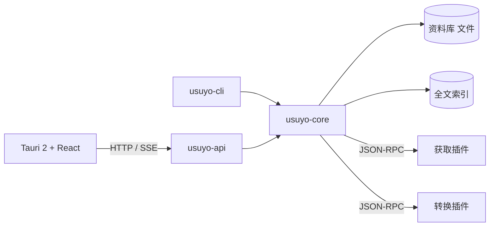

# usuyo

开源的本地优先桌面应用：把你在各平台收藏的内容备份到本机，转成可搜索的文字。

## 技术栈

| 层 | 实现 |
|---|---|
| 内核 | Rust 工作区（edition 2024），`crates/` 下 8 个 crate |
| 桌面壳 | Tauri 2（`apps/desktop/src-tauri`） |
| 前端 | React 19、TanStack Router / Query、Tailwind 4、Vite 8 |
| 插件 | 独立进程，经 JSON-RPC 与内核通信：获取（`usuyo-fetch/*`）、转换（`plugins/`：web、media、ocr-vision、asr-sherpa） |
| 存储 | 文件为准的资料库；全文索引可随时重建 |

| crate | 职责 |
|---|---|
| `usuyo-contract` | 资料库记录的类型与 JSON Schema |
| `usuyo-library` | 资料库读写 |
| `usuyo-index` | 全文索引（中英文分词、拼音） |
| `usuyo-plugin` / `usuyo-plugin-kit` | 插件协议、宿主、插件开发依赖 |
| `usuyo-core` | 引擎：任务队列、插件宿主、资料库与索引串联 |
| `usuyo-api` | 本机 HTTP 接口与事件（axum） |
| `usuyo-cli` | 命令行与守护进程 |

## 架构

## 运行

`just init && just check`；开发 `just dev`（守护进程）与 `just app-dev`（桌面窗口）；构建 `just build`。

## 许可证

内核 [AGPL-3.0](LICENSE)；对外契约 [crates/usuyo-contract](crates/usuyo-contract/) 为 [MIT](crates/usuyo-contract/LICENSE)。
