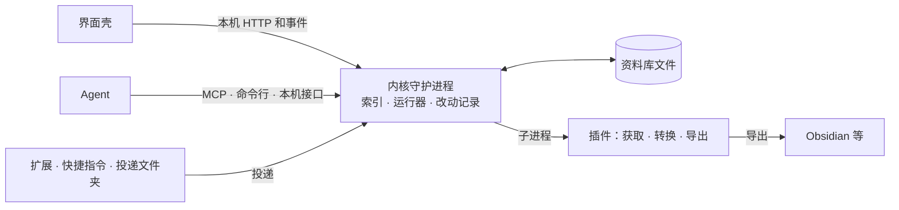

<a id="总纲做到哪了还剩什么怎么接着做"></a>
# 总纲：做到哪了、还剩什么、怎么接着做

状态：2026-11-11 起写，跟着代码改。这份写给接着写代码的模型（Opus 5.5 或别的）和以后查；用户不批这份，用户只看做出来的东西。

读的顺序：[CLAUDE.md](../CLAUDE.md) → 这份 → 要做的那条线的 feature doc（[docs/features/](features/)）。产品为什么做、做什么，在 [PRD](PRD.md)；用户逐条说过的话，在 [回答表](answers.md)。

<a id="1-用户定下的做法"></a>
## 1. 用户定下的做法

这些只在对话里说过，原话都记在 [回答表](answers.md)，这里是做事时要守的那几条。

- **分工。** 用户管想法、产品和效果；技术栈、架构、代码质量由主持的模型全权定。跟用户说话讲概念和效果，不讲技术细节，不拿规格让用户批。
- **直接做带界面的完整样子，不分阶段。** 一条线要做就做到用户在窗口里能用的完整样子，不先做命令行版，不切「第一版 / 以后」。文档里只写依赖顺序（谁要等谁），不写阶段、里程碑、版本。真的要等别的东西的，写清楚等什么。
- **命令行不再加。** 现有的几条命令（`init`、`add`、`get`、`search`、`reindex`、`daemon`）留着，是内核的入口和调试用的；新功能不配命令行，验收走界面和本机接口。
- **平台。** 小红书、微信视频号、B 站、X（推特）都要；其余的平台接着做，不排先后。平台的获取逻辑永远不进这个仓库（[CLAUDE.md](../CLAUDE.md) 原则 1）。
- **要账号的和不要账号的分开。** 每个平台按「这一样要不要账号」拆开；不要账号能拿到的（多半是单条的文字、图、视频），一律不带账号去取，登录了也不带；账号只用在非它不可的那几样上（多半是列出存过的），清单里写明是哪几样。
- **每一面都认出来、摆出来。** 机器不筛、不判断，判断留给人；只标特别明显的事；哪一面都不删。
- **机器做的每一步都留着。** 原样、提取出的文字、每一步分析都留着，指得回原样，能换个工具重做；从不顶替原样。不同角度、不同支线都欢迎。
- **删除就是删除。** 不留删除记录，不为兼容和防御加状态；边角的流程交给 Agent。
- **底层小，零件能换。** 以后要加检索、各种转换、个人 Agent、电脑操作，都挂在接口后面。
- **不制造压力。** 没有未读、待办、进度、清空这类字眼和计数。
- **文档不重复、不堆砌。** 一件事只写在一处，别处链接过去；旧版本靠提交的 diff 留着，文件里不留（见[文档怎么分](#8-文档怎么分)）。

<a id="2-干活的规矩"></a>
## 2. 干活的规矩

- **写代码按难度分。** 难的交给 Opus 5.5，机械的交给 Sonnet；被派出去的模型不提交，主持的会话读改动、自己重跑检查、再提交。
- **验证。** 仓库根 `just check`；`apps/desktop/src-tauri` 里 `cargo clippy --all-targets -- -D warnings` 和 `cargo test`；`apps/desktop/web` 里 `pnpm typecheck`、`pnpm lint`、`pnpm test`、`pnpm build`；动了哪个平台插件，就在它的仓库里跑它的 fmt、clippy、test。界面改了要在浏览器里看：`pnpm dev` 经代理连一个临时的内核。
- **不碰用户的真数据。** 测试和试跑一律用临时的 `USUYO_HOME` 和别的端口（47699 一带）。不在 47615 上起东西，不动 `~/Library/Application Support/usuyo` 和 `~/Documents/usuyo`，除非是给用户装好让他试（`just dev-plugins`、`just app`），而且先看应用是不是开着。
- **不从开发机请求平台。** 小红书、腾讯、B 站、X 的主机都不请求；平台插件的测试全离线，用假站点和样例。真平台、登录窗口、钥匙串、打包后的窗口，只有用户能试，交给他一张短清单。
- **凭据。** cookie、令牌的值只在钥匙串和单次调用的 0600 临时文件里，不进日志、报错、前端、资料库；宿主自己造的报错只写字段名。不读 `~/.ssh`、`~/.aws`、`~/.npmrc` 这类目录和文件。
- **删东西用 `trash`**，不用 `rm`。
- **提交和推送。** 开发期直接在 `main` 上写，一个提交一件事，信息写 `<scope>: <summary>` 加 `-` 开头的几行；不加任何 AI 署名。推送攒成批，推之前确认 `gh api user --jq .login` 是仓库的主人。
- **文档。** 改了行为就把 [SPEC](spec/README.md)、[插件协议](protocol/README.md) 写到和代码一样。文档里的交叉引用都要能点，标题前放显式的 `<a id>`；改完跑 `just docs <改过的文件>`（`tools/check_md.py` 查这几份的锚点和引用，`tools/resolve_links.py` 查全仓库的相对链接）。文档和代码对不上时，以 SPEC 为准；SPEC 有缺口就照[回答表](answers.md)里用户说过的方向补，并把补的地方写回 SPEC。
- **界面。** 照画布（仓库旁边的 `usuyo-canvas/`，README 里有页面清单和设计值）搬，但布局要能伸缩：画布是 1440 宽的定宽稿，窗口默认 1280×800、最小 720×480，定宽会叠在一起。图标用 lucide-react，不用表情符号。
- **平台名不进应用。** `apps/` 和 `crates/` 里，测试和样例库以外不出现任何平台的名字、网址、cookie 名；要用到就让插件清单声明。

<a id="3-现在做到哪"></a>
## 3. 现在做到哪

| 哪一块 | 做到哪 | 在哪 |
|---|---|---|
| 资料库（文件是真相） | 条目文件夹、快照、回收站、主题文件；按文件重建索引 | `crates/usuyo-library`、`crates/usuyo-contract`、[SPEC 第 1 层](spec/README.md) |
| 搜索 | 标题、正文、记一句；中文、拼音、首字母 | `crates/usuyo-index` |
| 插件宿主和 plugin-kit | 获取插件一次一进程；公网地址检查、逐跳核对跳转、大小上限；凭据经钥匙串交给单次调用；访客身份 | `crates/usuyo-plugin`、`crates/usuyo-plugin-kit`、[插件协议](protocol/README.md) |
| 内核 | 收下、取内容的任务和退避、按平台的节奏和暂停、导入（列出、预览、挑、收）、交进来的清单、收件夹、回收站到期 | `crates/usuyo-core` |
| 本机接口 | 一个口 127.0.0.1:47615；令牌、握手、只能交的令牌；事件流；列出回收站 | `crates/usuyo-api`、契约在 `apps/desktop/web/src/api/endpoints.ts` |
| 桌面壳 | 起内核、登录窗口、访客身份窗口 | `apps/desktop/src-tauri` |
| 平台插件 | 小红书（按链接取，清单由浏览器脚本交）、微信视频号（按分享链接取）、B 站（登录、列收藏夹、取）、X（按链接取，书签和喜欢由浏览器脚本交或读官方归档）；`just dev-plugins` 装这四个 | 仓库旁边的 `usuyo-fetch/`，各是一个仓库；[platforms](platforms/README.md) |
| 变成文字 | 格式、协议、plugin-kit 的循环、常驻转换进程、转录的写入和按层找、三个转换插件（`media`、`asr-sherpa`、`ocr-vision`）做了；模型下载、排任务、条目页和索引、接口、界面还没做 | [feature 003](features/003-transforms.md) |



- **内核守护进程**：资料库唯一的写方；索引删了能重建。
- **界面壳**：webview 里跑前端，只经本机 HTTP 和事件找内核（[ADR-002](decisions/ADR-002-frontend-stack.md#和内核的接口)）。

仓库怎么分：

| 位置 | 管什么 | 依赖 |
|---|---|---|
| `crates/usuyo-contract` | 资料库的类型和 JSON Schema（MIT） | 无 |
| `crates/usuyo-library` | 文件就是真相的那一层：id、路径、读写、改动记录、回收站、op | contract |
| `crates/usuyo-plugin` | 插件协议的类型和宿主（MIT 的协议类型放这里的 `protocol` 模块） | 无 |
| `crates/usuyo-index` | 能重建的索引和搜索 | contract、library |
| `crates/usuyo-core` | 把上面几样串起来：收下、任务、转换的调度 | 上面全部 |
| `crates/usuyo-api` | 本机 HTTP 和事件 | core |
| `crates/usuyo-cli` | `usuyo` 这个可执行文件 | core、api |
| `plugins/web` | 预装的通用网页获取插件 | plugin 的协议类型 |
| `apps/desktop/src-tauri` | 壳 | 无（只启动 daemon） |
| `apps/desktop/web` | 前端，照 [ADR-002](decisions/ADR-002-frontend-stack.md) | 本机接口 |

接口做到哪（都还不算定稿）：

| 接口 | 状态 | 缺什么 |
|---|---|---|
| [插件协议](protocol/README.md#01-读者与状态) | v1 草案；宿主和 plugin-kit 有了第一版（[§3.13](protocol/fetch.md#313-宿主和-plugin-kit-现在做到的11-11)、[§10.1](protocol/plugin-kit.md#101-plugin-kit-的-http-客户端11-11)） | [待定](protocol/open.md#13-待定)里还有没答的；沙箱、本机代理、`serve`、`usuyo plugin check` |
| 资料库格式（[SPEC §1](spec/library.md#1-资料库-v1第-1-层)） | v1 草案，`crates/usuyo-contract`、`crates/usuyo-library` 照它实现 | 联网后并身份；同步（[008](#008-文字同步)） |
| 改动提议、改动记录（[SPEC §1.5](spec/library.md#15-改动提议)、[§1.6](spec/library.md#16-改动记录)） | v1 草案，资料库层能写能撤 | 接受提议的流程、界面（[006](#006-agent)） |
| 宿主 ↔ 界面（[SPEC 本机接口](spec/local-api.md#本机接口第-2-层11-11-照代码)） | 照代码写了；契约文件是 `apps/desktop/web/src/api/endpoints.ts` | 窗口用的路径还不带 `/v1/`、分页、OpenAPI 描述 |
| 内核推的事件 | server-sent events，八种事件（同上） | 补发、信封 |
| MCP 工具 | 没写，没实现 | 内核服务契约和工具（[006](#006-agent)） |
| 命令行 | `init`、`add`、`get`、`search`、`reindex`、`daemon` | 不再加命令（[§1](#1-用户定下的做法)） |
| 搜索语法 | tantivy 索引能搜；语法没写 | 查询串、筛选、分页（[006](#006-agent) 的契约里定） |
| [投递接口](protocol/delivery.md#5-投递接口) | `/v1/ping`、`/v1/deliver`（只收链接）、`/v1/batches` 和按投递端发的令牌做了，和窗口用的路由同一个监听口 | 已取到的内容（multipart）、批次查询 |
| [导出与读回](protocol/transform-export.md#44-导出的-run-与-readback) | 草案 | 笔记库里的文件形状（[007](#007-导出读回和别的工具的导出)） |
| 配置、版本策略（[SPEC §0.2](spec/conventions.md#02-版本与兼容)、[§1.1](spec/library.md#11-目录树)） | v1 草案 | 设置的完整清单（[010](#010-设置第一次打开收下浮层)） |
| 订阅源 | 没有 | 你填的地址、订阅对象（[009](#009-跟着收)） |

已经做完的两条线：001 收下一条（收下、存好、搜到、在窗口里看到），002 平台（登录、列出、导入、交进来的清单）；它们的做法已经写进 [SPEC](spec/README.md)、[插件协议](protocol/README.md) 和 [apps/desktop/README.md](../apps/desktop/README.md)。它们剩下的、不归哪条线的：

- 壳起的内核，在壳没了（被信号杀掉、崩溃）以后该自己退出；现在留着接着跑，下次启动的壳找到它接着用（[apps/desktop/README.md](../apps/desktop/README.md#打开以后)）。
- Safari 的 Userscripts 没有网站访问权限时先发 CORS 预检，投递接口（`/v1/…`）现在不答，请求就失败；这几条路径要答预检，只放扩展的来源。
- SPEC 里标「11-11 还没做」、插件协议里写「还没做」的：联网后并进平台身份、`inputUrl` 记原链接、列表分页、`blocked` 现在只暂停一小时、沙箱（[012](#012-插件的安装和分发)）。回收站到期移除、凭据、节奏、「现在再试」已经做了，那几处正文还要照代码改。
- 和代码对不上的说明：`crates/usuyo-plugin-kit/README.md` 说 `Client::new` 不认环境变量，测试例子少两个字段；`crates/usuyo-plugin-kit/src/http/address.rs` 开头的注释说只用 `Policy::strict`，`crates/usuyo-api/src/lib.rs` 开头的说事件能用 `EventSource` 读。

至今没人验过的：打包后的窗口本身、登录窗口、四个平台的真实请求。只有用户能试。

<a id="4-界面清单"></a>
## 4. 界面清单

「完整」照画布的页面算。每一页做的时候都接真内核，不留样例数据的页。

| 画布页 | 应用里 | 还差什么 | 靠哪条线 |
|---|---|---|---|
| 主页（地图在前，搜索浮在上面） | 有，接着真数据 | 主题那一片清楚、雾的摆法、按来源重排的位置不认平台名（现在 `fog/places.ts` 按平台名摆）；画布上三处还没定的摆法等用户 | [004](#004-拼成思路) |
| 搜索 | 有 | 搜到口播、图里的字、画面里的字时的层和定位 | [003](#003-变成文字) |
| 条目页 | 有 | 几面并排、每面的来源、「再转一次」「换一个转」、划线、引用 | [003](#003-变成文字)、[005](#005-你写的那一层) |
| 主题页 | 没有 | 整页 | [004](#004-拼成思路)、[005](#005-你写的那一层) |
| 改动记录与改动提议 | 占位 | 整页 | [006](#006-agent) |
| 跟着收 | 占位 | 整页 | [009](#009-跟着收) |
| 获取插件 | 有 | 转换插件和模型那一栏；从网上装插件 | [003](#003-变成文字)、[012](#012-插件的安装和分发) |
| 设置 | 占位 | 整页：外观、Agent、同步、存储与回收站、诊断 | [010](#010-设置第一次打开收下浮层) |
| 导入 | 有（平台的清单和交进来的清单） | 别的工具导出的文件那一半 | [007](#007-导出读回和别的工具的导出) |
| 导出到 Obsidian | 占位 | 整页 | [007](#007-导出读回和别的工具的导出) |
| 回收站 | 有 | 画布上和导出有关的那一段；占用大小、改保留天数、批量选 | [007](#007-导出读回和别的工具的导出)、[010](#010-设置第一次打开收下浮层) |
| 第一次打开 | 没有 | 整页 | [010](#010-设置第一次打开收下浮层) |
| 收下浮层 | 有页面，没有全局快捷键 | 快捷键、托盘 | [010](#010-设置第一次打开收下浮层) |
| 空资料库 | 有 | — | — |
| 早先的地图探索三张 | 不做 | 主页的做法定了以后画布上会拿掉 | — |

<a id="5-功能线"></a>
## 5. 功能线

每条线写：已经定的、要做成什么样、靠什么。写到 [feature 003](features/003-transforms.md) 那样细的 feature doc 还没有的，先照这里的决定写一份，再动手。

<a id="003-变成文字"></a>
### 003 变成文字

设计、决定、工作包、验收都在 [feature 003](features/003-transforms.md)。做完的：在这台量速度（WP0）、格式和协议（WP1、WP2）、常驻转换进程（WP3）、转录的写入、列出和按层找（WP5）、三个转换插件 `builtin/media`（WP9）、`builtin/asr-sherpa`（WP10）、`builtin/ocr-vision`（WP11），都在 `plugins/` 下、测试全离线。剩下的：模型下载（WP4）、排任务和编排（WP6）、条目页的数据和索引（WP7）、接口（WP8）、界面（WP12）、测试用的获取插件（WP13），以及让 `just dev-plugins` 把三个转换插件也装上；照那份的[工作包](features/003-transforms.md#10-工作包)一节，条目页和获取插件页上的那些按钮一起做完。

<a id="004-拼成思路"></a>
### 004 拼成思路

设计的来历在[调研 16](research/16-piecing-engine.md)。那份把事情切成五个阶段；用户说不分阶段，所以这条线做的是前四个阶段合起来的完整样子，第五个阶段（个人 Agent、电脑操作）归 [006](#006-agent)。

已经定的：

- 最小的素材是**一段**，不是一条：一句口播、一行图里的字、一段正文、一帧画面，带着指回原样的坐标（哪个快照、第几秒、哪张图的哪一块）。一条收藏可以被不同的思路各取一段。003 交出来的就是这样的段。
- **线头**（机器拼出来的一组相近的段）标「机器挑的」，只摘原话，不替你写总结，不起名；你留下它，它才变成主题。线头没有「看过」的状态。
- **关注**一个主题，地图上那一片就一直清楚；其余的留在雾里。产品不驱散雾。
- 找相近的：全文加本机向量两路检索再合并；向量模型在本机跑，挂在转换接口后面，能换。图和关键帧也算向量，拼出素材那一类的线头。
- **多个角度和支线**：一个角度是一份配方（让模型按某个问题去读一组段），每次跑留一份记录，引用由机器另行核对到原话；同一组段可以分出不同的支线并排放。模型由用户选，调用由宿主代发。
- 机器产出的都能重算，放 `derived/` 和资料库的 `.usuyo/` 下，照 003 的「一次一个文件夹、写了不改」。
- 跟着收的命中默认看标题层加内容层，画面层不算（[SPEC 要你看一眼的第 7 条](spec/library.md#110-要你看一眼)）。

要做成的样子：主页地图上主题和线头的摆法、主题页（成员、命中方式、关键词）、读一条时旁边列相近的段、搜索用两路检索、角度和支线在主题页上并排。

靠：003（段和坐标）。

<a id="005-你写的那一层"></a>
### 005 你写的那一层

文件的样子已经在 [SPEC 第 1 层](spec/README.md) 定了：记一句在条目的 `notes.md` 头部，划线在 `highlights.md`，主题页、卡片、成稿是按标题起名的 Markdown，只有 usuyo 写的一小套 YAML 头；在 usuyo 外面改过的文件照同步那套三方合并读进来；在访达里改名就是改标题。

已经定的：

- 引用是一个指回原样的链接（哪一条、哪一层、第几秒或哪一块），重新识别不会让它断。
- 模型和 Agent 只能起草卡片和成稿，改已有内容先提议（[CLAUDE.md](../CLAUDE.md) 原则 6）。
- 整理是可选的，没有「未整理」。

要做成的样子：条目页上的记一句和划线；主题页的正文、引用、成员、卡片；成稿页（把引用的段带着出处拼进一篇自己的东西）；从任何一段一键引用到主题页或成稿。

靠：003（段）、004（主题）。

<a id="006-agent"></a>
### 006 Agent

已经定的：

- 对外只有 MCP（和以后的 ACP），不加命令行。
- 读：搜索、读条目、读段；返回的内容带 `untrusted: true` 和来源。写：收下新条目直接生效，记进改动记录、标明是哪个 Agent，能整批撤销；改已有内容先生成提议，用户确认后才生效。没有删除，没有外发；Agent 能撤掉它自己收的、用户没写过东西的条目。
- 私密条目：Agent、本机接口、不在终端里的命令行来收同一条时回 `skipped`。
- 提议不作废。

要做成的样子：MCP 服务（内核里的一个入口）；改动记录与改动提议那一页（按批看、接受或不要、撤销和重做）；设置里 Agent 那一栏（开关、哪个 Agent 做过什么）；004 的角度可以由外面的 Agent 经 MCP 交一份分析进来。个人 Agent 和电脑操作都只用搜索、段、分析记录、改动提议这几样，内核不为它们加东西。

靠：005（改动提议要落到的那些文件）。

还没做的：

- 私密条目回 `skipped`：本机接口的 `POST /items` 现在一律记成窗口里收的（`via: app`），私密的照收；命令行也从不跳过。投递接口里扩展、手机、`api` 令牌的已经会跳过（[SPEC 本机接口](spec/local-api.md#本机接口第-2-层11-11-照代码)）。
- 写 MCP 之前先写内核服务契约：一份描述（[OpenAPI 3.2](https://github.com/OAI/OpenAPI-Specification/releases)）派生本机 HTTP 和 MCP，生成客户端和文档；含搜索语法（自己的小语法：`字段:值`、引号、`-`、`after:`，不把索引实现绑进接口）、事件、端口。界面用的那一半已经照代码写进 [SPEC 本机接口](spec/local-api.md#本机接口第-2-层11-11-照代码)，契约文件是 `apps/desktop/web/src/api/endpoints.ts`。一起定：Agent 连接名从哪来、MCP 收下工具的 `pickedBy`、撤销工具（能撤哪些已定，[SPEC §1.10 第 18 条](spec/library.md#110-要你看一眼)）、错误和输出 schema 怎么配、游标有效期、各处的间隔、上限和文案。原先留在 SPEC 里的 v0 草案（仓库布局、标签、去重、命令行、MCP 工具、索引）在 `e654e08` 删掉了，`git show e654e08^:docs/SPEC.md` 里还看得到「留着的 v0」那一节，写契约时拿来对照。

ACP 会话在窗口里只显示它交来的改动提议和权限请求，不显示对话本身。

<a id="007-导出读回和别的工具的导出"></a>
### 007 导出、读回和别的工具的导出

已经定的（[ADR-003](decisions/ADR-003-plugins.md)、回答表 11-06）：

- 导出只在用户点的时候做，目标先是 Obsidian；导出是第三类插件。
- 读回留着：照导出反着跑一遍，用同步那套三方合并；每个对象的底稿记在按机器目录的 `exports/<目标>.json`；条目笔记里只多一行分隔；有问题的文件既不读也不写。
- 删掉一条以后，已经导出去的副本不管。
- 别的工具导出的文件能导进来（官方预装的两样之一，另一样是通用网页获取）。

要做成的样子：导出到 Obsidian 那一页；导入页上「别的工具导出的文件」那一半（选来源、扫描、预览、导入、记录）；官方组织里一个和平台无关的「链接清单导入」，读 JSON、CSV；回收站页上和导出有关的那一段。

靠：005（要导出的那些文件）。

<a id="008-文字同步"></a>
### 008 文字同步

设计在[调研 14](research/14-sync-like-hatoba.md)。已经定的：跑在用户自己的 Cloudflare 账号里（Worker 加 D1），离开本机前端到端加密，没有本产品的服务器；同步文字和机器转出的文字，媒体不同步；改到同一处用三方合并；转换只在最早收下的那台做。

要做成的样子：设置里同步那一栏（接上自己的账号、配第二台设备、看状态）；内核里的同步任务。

靠：资料库 v1（已有）。媒体同步（R2）和别的后端（WebDAV）各是要等这条线做完的另一件事，等的是这条线，不是版本。

<a id="009-跟着收"></a>
### 009 跟着收

已经定的：订阅的可以是收藏夹、创作者主页、关键词；宿主定时调插件的 `list`，不要插件自己常驻；每个订阅在 `jobs.db` 里记看过的哈希，不留删除记录；按关键词命中的和 Agent 找来的都标「机器挑的」，一直留着这个来历；命中默认看标题层加内容层，相似度要用户自己打开；节奏照插件声明的。

要做成的样子：跟着收那一页（订阅、试跑一次看会收下什么、最近收下的）；内核里的定时任务。

靠：002（列出和节奏，已有）、003（内容层）、004（相似度）。

协议还缺的：

- 订阅：`resolve-source`（带 `owner`）、`sourceItemId`、url 和 ref 谁先、第一次拉只记不收、`origin.subscription`、`feed:` 按主机算节奏。
- `sites[].site` 能引用设置项，才能跟着收自己阅读器里的星标。
- fetch 输出加 `textOrigin`，标明原文是机器写的，才能读 Horizon 这类输出。

<a id="010-设置第一次打开收下浮层"></a>
### 010 设置、第一次打开、收下浮层

要做成的样子：设置页（外观；Agent；同步；存储与回收站：资料库在哪、回收站留几天、时钟跳了以后要不要照时间清；诊断：读不了被跳过的条目、日志在哪）；第一次打开的引导；全局快捷键唤出的收下浮层和托盘。

已经定的：资料库第一次打开时建在「文稿」里的 `usuyo`；回收站自己到期，到期前随时拿得回来。

靠：各条线各自的那一栏跟着那条线做，这里做壳和「存储、诊断、外观」。

还没做的：回收站的「照时间移除」（时钟守卫拦下以后用户点了才放行，[SPEC §1.7](spec/library.md#17-删掉)）内核里有这条路，还没有接口和界面；设置要先列全 `settings.json` 的清单。

关掉主窗口后 usuyo 留在菜单栏（Windows 是托盘），快捷键、扩展、跟着收、MCP 照常；菜单栏图标不显示任何数字。开机启动默认关，第一次打开跟着收或全局快捷键时问一句要不要开机启动。还没有获取插件能取的链接，条目上写「只有链接：还没有能取它的获取插件」，旁边一个「添加来源」，打开来源设置，不点名任何来源。

<a id="011-更多平台"></a>
### 011 更多平台

**一个平台一个插件，插件里有几种方法。** 每种方法有自己的层级、要不要账号（账号在哪里被用到）、做没做、记录到的风险；用户在获取插件页上逐个开关。不带账号的方法默认开着；要登录的，登录以后开；`private-api`、`client-hook` 这两档默认关着。同一样东西有几种方法取得到时，先用层级低、不带账号的；它说缺了哪几样，再换声明了那几样的方法。账号只交给列了那个站点的方法，所以「只有某一样要账号」写成另一种方法就行，不用别的字段。要改客户端的方法放单独的组织，一个平台在那边另有一个仓库。

现在的清单还是「一个插件一种取法」。要改的：清单里加 `methods`（每种方法自己的 `access`、`login`、`sites`、`visitors`、`interaction`、能力和产出，没做的也写上并标明），宿主按方法找能力、按方法交凭据和记暂停，本机接口和获取插件页按方法摆，四个插件的清单和入口跟着改。这件事排在变成文字的调度做完之后。

每个平台有哪些方法、各包哪个现成工具、哪些能不带账号在这台机器上真测，在 [platforms/routes.md](platforms/routes.md)；总表和怎么相对安全地试在 [platforms/README.md](platforms/README.md)。插件仓库的说明照 `usuyo-fetch/x` 那一份的写法：开头一张方法表，每种方法一节，只陈述事实。

- **做了的**：小红书（公开笔记页加访客身份；浏览器脚本交收藏和赞过）、微信视频号（分享链接的匿名接口；腾讯元宝换视频）、B 站（公开接口取单条；登录后列收藏夹和稍后再看）、X（访客接口和嵌入接口取单条；浏览器脚本交书签和喜欢；读官方归档）。对真平台跑过的只有 B 站的单条。
- **接着做的**，按用得多的排：手机镜像的驱动（[platforms/phone.md](platforms/phone.md)），用它做视频号「赞和收藏」和小红书收藏的方法；包 yt-dlp 的通用视频插件；抖音、快手的分享页；公众号的文章页和微信收藏；微博的访客身份和浏览器脚本；其余照 routes.md。
- 插件出门要走和浏览器一样的路（跟系统代理）；没有它，被墙的平台在这台机器上取不了。在做。

应用这边不用为新平台改任何东西；要改，说明清单或协议缺了一种声明，补协议，不在应用里写平台名。

清单和协议还缺的：

- 按关键词和创作者主页列、可选的评论、扫码登录（[插件协议待定](protocol/open.md#13-待定)第 26–28 项）。
- 导入取什么：现在导入时取内容不带 `want`，每条按默认全取；节奏里加一个字段说导入取什么，才能导入先只取文字。
- 交来的链接多久失效（小红书的 `xsec_token` 只有几个小时），导入页才好写「今天收下这些」。

大批量导入照节奏按天分批跑完，导入页写明大约要几天；用户调高节奏上限时不拦、不弹窗，只提示有插件建议更慢。

<a id="012-插件的安装和分发"></a>
### 012 插件的安装和分发

已经定的（[ADR-003](decisions/ADR-003-plugins.md)、[插件协议](protocol/README.md)）：官方组织只放通用的东西；平台获取插件放用户自己的获取插件组织，client-hook 类单独一个组织；档位和登录要求只是给用户挑的标签，不拦。

要做成的样子：从网上装和更新插件（来源、校验、签名）；插件的沙箱（文件、网络出口经宿主的本机代理）；插件开发指引；官方插件仓库和契约测试。组织和账号由用户注册。

还没做的：

- 校验用 GitHub App：无服务器中转接 webhook，官方组织的 Actions 拉插件、跑契约测试、写回 check run（[回答表](answers.md)）；[ADR-003 §6](decisions/ADR-003-plugins.md#6-分发与校验) 写了，[插件协议 §8.3](protocol/distribution.md#83-校验与来源证明)还没写。`usuyo-fetch` 把发版用的可复用工作流复制一份放进自己的 `.github`，来源证明的签发者是它自己，不出现官方组织；plugin-kit 改工作流时同步一次。
- 插件的 schema 文件和 plugin-kit SDK 的形状；运行器和 `crates/usuyo-plugin-kit` 已经有了（[插件协议 §3.13](protocol/fetch.md#313-宿主和-plugin-kit-现在做到的11-11)）。
- client-hook 插件放 `usuyo-fetch-hook`，添加来源时能一次加两个（[插件协议 §8.4](protocol/distribution.md#84-三种来源)、[§8.8](protocol/distribution.md#88-获取方式组织的仓库结构)）。
- 预装的通用网页获取：`builtin/` 的身份和发版对上[插件协议 §8.4](protocol/distribution.md#84-三种来源)；`web` 不用 `match`，按主机分节奏。
- 权限里加连本机 Unix socket，只在第三方包装现成工具时要。

<a id="013-打包和更新"></a>
### 013 打包和更新

要做成的样子：三个系统的安装包；macOS 签名和公证（要用户的开发者账号）；应用自己更新；CI 跑检查、编精简的 ffmpeg（见 [feature 003](features/003-transforms.md#43-ffmpeg-和模型怎么到这台电脑上)）。

bundle id、MCP `_meta` 自定义键的前缀、schema 的 `$id` 都从用户给的域名派生（域名是 example.com 时 bundle id 是 `com.example.usuyo`），第一次发布前定下；`$id` 只是标识，不要求能访问。域名下只放一页说明和 schema 副本，不做官网。应用先只提示有新版本并链到 Releases，Homebrew 装的用 brew 升级；签名和公证做好以后，改成应用内下载、提示重启。

<a id="6-依赖顺序"></a>
## 6. 依赖顺序

不是阶段，只是谁要等谁。没有箭头连着的可以同时做。

```
003 变成文字 ──▶ 004 拼成思路 ──▶ 005 你写的那一层 ──▶ 006 Agent
                      │                    └──────────▶ 007 导出和读回
                      └──▶ 009 跟着收（相似度那一半）
008 文字同步        （只等资料库，已有）
010 设置的壳        （不等谁；各栏跟着各条线）
011 更多平台        （不等谁）
012 插件安装和沙箱  （不等谁）
013 打包和更新      （不等谁；签名等用户的账号）
```

<a id="7-只有用户能答的和能验的"></a>
## 7. 只有用户能答的和能验的

**问过、还没答的**（都不挡着写代码，括号里是没答时照着做的）：

- 回头用一条收藏时，更常是取里面一段，还是拿整条当例子？（照取一段做）
- 最后输出的是什么：文章、视频脚本、帖子，还是只给自己看的笔记？（成稿页先当文章做）
- 收藏里观点和审美素材各占多少？（两类线头都做）
- 个人 Agent 主要替你做什么？（先给它搜索、收下、提议这几样）
- 回收站的「时钟跳了就先不清」留不留？拦下以后要不要在某种情况下自己放行（时钟回到合理范围，或拦了几天以后提醒）？（先留着，只在用户点了以后放行）
- 成稿引用了私密条目，导出到 Obsidian 和给 Agent 时各怎么办？用户说等有界面和具体例子再定（照 [SPEC 要你看一眼第 13 条](spec/library.md#110-要你看一眼)现在的写法）。
- 浏览器里打开 `channels.weixin.qq.com/web/pages/home` 扫码登录以后，有没有你的「赞过」「收藏」？电脑上的微信里，视频号的「赞和收藏」看不看得到，一条视频能不能复制出 `weixin.qq.com/sph/` 链接？（照都没有来做：链接从手机上复制，经通用剪贴板到电脑；有的话做[视频号的浏览器脚本](platforms/routes.md#4-视频号)）
- 订阅来的默认只收挑的，还是也收命中关注的？平时用哪个阅读器（决定先接 Google Reader API，还是 Readwise、Folo）？（默认只收挑的；阅读器先不接哪一家）

**还没问的**（括号里是问之前照着做的）：

- 地图的几处摆法：最先浮出来的字从哪来、跟着收进来的点更亮还是更淡、一张还是多张、怎么画、换排法和位置稳定怎么并存、旁边的面板盖住地图还是让出宽度、「视图」是不是地图的排法，在画布原型上问。（照画布上现在的做法）
- 对外怎么介绍：品类词、口号、先讲给谁、口播稿用痛点还是名字开头。（照 [PRD 的一句话](PRD.md#3-是什么和不是什么)，口播稿用痛点开头）
- 致谢里的 `echo` 是不是 echotrace，视频号那条 AfUjcHEzn8 是哪个项目？（维持现在的推断）

**只有用户能验的**：打包后的窗口；B 站、腾讯元宝的登录窗口；小红书的访客身份和浏览器脚本；用到账号的取法真取一条、真导入一批；钥匙串弹不弹框。不用账号取单条，2026-11-12 这边对着真平台跑过：B 站、X（经系统代理）、视频号（作者、描述、封面、发布时间；没有视频）；小红书还没跑。

**公开之前要用户定的**（还没问）：哪些文档公开，插件详情里附不附各层的已知情况；要不要付费签名、开不开捐赠、致谢列哪些；找不找法律意见，GPL、AGPL 的程序随不随安装包（ADR-003 定稿等它）；用哪个域名（bundle id 等它，见 [013](#013-打包和更新)）；声明怎么写；社交平台账号占哪几个（只占打算真发内容的一两个）；你的原话能不能照用进公开文案（README 先只用 PRD 3 里引的那一句）；传播从哪开始（等桌面版能演示，发 README 加中文平台短演示，只用你自己的收藏夹）；获取插件组织接不接外部贡献（先只收已有插件的修复）；主仓库和应用里点不点 `usuyo-fetch` 的名字（先不点名，获取插件组织的 README 放一个 `usuyo://` 链接，点了显示一次声明再添加）。

**要用户去办的**：注册 `usuyo`、`usuyo-fetch`、`usuyo-fetch-hook` 三个 GitHub 组织和 `@usuyoapp` 账号，占 npm、PyPI、crates 上的 `usuyo`（查的时候都空着，但空着不保证能注册，尽早）；公开前查第 9、42 类商标（J-PlatPat、USPTO、中国商标网）；macOS 签名用的开发者账号；开两个专用的权利人通知地址（官方组织用你域名下 `legal@` 一类，`usuyo-fetch` 另开一个不在你域名下的邮箱），定了换掉协议里的 `{contact}`；换掉那个在工具输出里露过一次的 npm 令牌。

<a id="8-文档怎么分"></a>
## 8. 文档怎么分

规矩：

- **一件事只写在一处。** 别处要用就链接过去，不抄一遍。写之前先找有没有地方已经写了。
- **文件里不留旧版本。** 不留「历史」「v0」「原先设想」这类段落，不留带日期的改动说明；旧的靠 git 的 diff 看。所以改文档前先把现状提交，再改，一步一个提交，不改写历史。
- **按谁来读分。** 一份文档只给一种读法：规则、产品、规格、协议、某个平台、某条线的做法、背景调研，各在各处；读的人不用为了一小段读一整份长文。
- **调研是背景，不是规范。** 定下来的东西写进规格、协议、平台、功能线的文档；调研里只留当时查到的事实。

整理到哪了（挪一份提交一次）：

| 放哪 | 写什么 | 做到哪 |
|---|---|---|
| `CLAUDE.md` | 给模型的规则：原则、技术栈、约定、命令、文档地图 | 整理完 |
| `docs/BUILD.md` | 这份：做到哪、界面清单、每条线的决定、依赖顺序、规矩、要用户答的验的办的 | 整理完：原来的 `TODO.md`、`overview.md`、`discussion.md` 并进来了 |
| `docs/PRD.md` | 产品：为什么做、是什么、原则、用到的词、功能、不做什么 | 整理完：原来的 `product-model.md`、`overview.md` 讲产品的部分并进来了 |
| `docs/answers.md` | 用户逐条说过的话，一张表 | 整理完：`open-decisions.md` 拆完删掉，回答搬到这里，定了的登记项并进产品、规格、协议和这份的各条线，没定的进[只有用户能答的](#7-只有用户能答的和能验的) |
| `docs/spec/` | 内核的规格，按约定、资料库、本机接口、按机器的目录分开 | 整理完：原来的 `SPEC.md` 拆开，v0 各层删掉（旧稿见 [006](#006-agent)）；内核服务契约等 006 写 |
| `docs/protocol/` | 插件协议，按清单、获取、转换和导出、投递、凭据、隔离、分发、包装现有工具、plugin-kit、设计取舍、待定分开 | 整理完：原来的 `plugin-protocol.md` 拆开，采纳情况、旧字段对照、带日期的说明去掉，待定里定了的项删掉，编号不动 |
| `docs/platforms/` | 获取方案：层级怎么定、要账号和不要账号怎么分、各平台的总表、怎么相对安全地试；每个平台一份 | 小红书、视频号、B站（从调研 15 挪来）、X 各一份；`research/notes/` 和调研 06 里定下来的部分还没挪 |
| `docs/features/` | 正在做的线的做法；做完的并进规格以后删掉 | 001、002 并完删掉了；003 正在做 |
| `docs/decisions/` | 还有效的架构决定；被取代的删掉 | 整理完：ADR-001 删掉，ADR-003 的修订并进正文 |
| `docs/research/` | 调研原文，只当背景；索引里写明哪份已经被哪份现行文档取代 | 索引写了 15 挪去了哪；别的几份被哪份取代还没写 |

