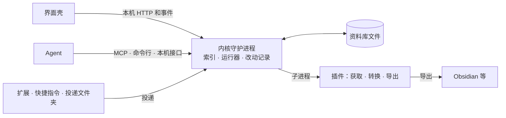

# 整体设计（供 review）

内部文档：写了平台名和首批计划，公开前按 [O2](open-decisions.md#13-开源与发布) 处理。

v0.1 · 2026-11-04。名字没定：正文写「本产品」，标识写 `{name}`（如 `.{name}/`、`{name}_id`）。`{fetch-org}` 是你自己的获取插件组织，跟产品名一起定（配 Dokokara（暂名）的是 `ekinaka`）。插件协议里的 `seelu`、代码里的 `xiecun` 都是旧占位。

## 0. 一屏读完

- **是什么**：在推荐流外，维护一套你自己的思路：收下的内容原样存在你电脑上，能搜，摆在点阵迷雾地图上。
- **已定**：见 [§3](#3-已经定了的)；原则是 CLAUDE.md 的六条（[PRD §4](PRD.md#4-原则) 扩成九条）。
- **待定**：17 条，按 [discussion](discussion.md#1-什么东西进资料库) 的顺序一次问一条。
- **接口**：设计了一半。插件协议是 v1 草案，其余多在 v0 或只有一句（[§5](#5-接口做到哪了)）。
- **语言**：Go 内核加 MyGo 壳（11-04 定）；只做桌面，手机以后原生重写；MyGo 出问题换 Wails v3。
- **wx-cli**：2026-07-15 起被 GitHub 屏蔽（腾讯方面的 DMCA），你这台微信 3.8.8.19 也用不了。建议 `{fetch-org}` 不收微信 client-hook 插件，导出文件照 official-export 导入，见 [9](discussion.md#9-自己的获取插件组织收什么)。
- **RSS、Horizon**：建议在现成阅读器里读，加星算收下；Horizon 当普通 feed，见 [1](discussion.md#1-什么东西进资料库)。

## 1. 先读这四份

本篇 → [PRD](PRD.md#0-状态与读法) → [discussion](discussion.md#1-什么东西进资料库) → [TODO](TODO.md#1-等你回答)。时长估计：10、25、每条 3、5 分钟。

## 2. 产品是什么

本产品把你收下的内容原样存到你电脑上，转成能搜的文字。收下只说明它勾住过你；只收下、从不整理，也是正常用法。真正记下你判断的只有两件事：让哪一片一直清楚，写下哪句话。机器写的转写和摘要都标明出处，排在你的话下面。本产品不拦你刷，不替你挑外面的信息（[07 §1](research/07-positioning-and-naming.md#1-这是什么东西)）。

## 3. 已经定了的

| 什么 | 哪天 | 你的话或出处 |
|---|---|---|
| 六条原则：平台中立、raw 不改写、文件是真相、不制造压力、入库内容不可信、Agent 先提议 | 10-20 | [CLAUDE.md](../CLAUDE.md) |
| 不分里程碑：产品逻辑 → 界面 → 实现 | 10-21 | [O8](open-decisions.md#13-开源与发布) |
| 「放下」（看完让一条退场的动作）不做；技术栈每一层都用最新稳定版 | 10-28 | [product-model](product-model.md)；[ADR-002](decisions/ADR-002-frontend-stack.md) |
| 点阵雾加现代界面；终端风格否掉；变化走同一个时钟 | 10-28、10-29 | [§1.7](open-decisions.md#17-11-04-回复记下的) |
| 定位和一句话，见 [§0](#0-一屏读完) | 10-30、11-01 | 「按建议」（[S3](open-decisions.md#14-11-01-第二次回复定下的)） |
| `access` 七层加 `login` 是标签不是闸门；按你排的顺序换；后果由你担；client-hook 可以装 | 11-01 | [D-a 至 D-e](open-decisions.md#11-十条方向)；[§1.3](open-decisions.md#13-随之改写的文档) |
| 获取插件放 `{fetch-org}`，一个插件一个仓库，客户端不预置插件来源；只预装通用网页获取和别的工具导出的导入 | 11-01 | [D-f](open-decisions.md#11-十条方向)；「同意」（[P1、P3](open-decisions.md#14-11-01-第二次回复定下的)） |
| 只做开源，不商业化；内核 AGPL-3.0，plugin-kit 用 MIT | 11-01 | [D-i](open-decisions.md#11-十条方向)；[ADR-003 修订](decisions/ADR-003-plugins.md#修订-2026-11-01) |
| 不用 Seelu，只定英文名；倾向 Dokokara，没定 | 11-01、11-03 | 「然后Dokokara我感觉挺合适」（[§1.6](open-decisions.md#16-11-03-回复记下的)） |
| 不要角色或动物（M14 关，M10–M13 不再问）；调研过的方案都能做成插件，`{fetch-org}` 收哪些见 [9](discussion.md#9-自己的获取插件组织收什么)；兼容和开创都要，以后支持 RSS、Horizon 一类，是方向，见 [17](discussion.md#17-兼容和开创各指什么) | 11-04 | 「不要角色或者动物」（[§1.7](open-decisions.md#17-11-04-回复记下的)） |

**定了、11-04 重问后确认**：Go 加 MyGo（10-21，[ADR-001](decisions/ADR-001-stack.md)），只做桌面，退路 Wails v3（[6](discussion.md#6-桌面壳)、[7](discussion.md#7-内核语言)）；分发用 GitHub App（10-28，[ADR-003](decisions/ADR-003-plugins.md)），11-04 重问后照旧（[8](discussion.md#8-插件怎么校验)）。

**雾的意思（11-02 你说，11-05 确认）**：雾是收了一大堆之后的脑雾（「不知道从何开始去处理」，[§1.5](open-decisions.md#15-11-02-回复记下的)）；产品不驱散它，只给口子，其余的留在雾里也没关系。让一片一直清楚的动作叫「关注」（[2](discussion.md#2-地图上一直清楚的是什么)）。

## 4. 整体结构

- **内核守护进程**：资料库唯一的写方；索引删了能重建。
- **界面壳**：webview 里跑前端，只经本机 HTTP 和事件找内核（[ADR-002](decisions/ADR-002-frontend-stack.md#和内核的接口)）。

## 5. 接口做到哪了

答「接口文档我们设计好了吗」：设计了一半。22 项（下表并成 12 行）没有一项算「已设计且一致」；SPEC、`pkg/contract` 和插件协议、product-model 之间有 [18 处对不上](SPEC.md#附和别的文档对不上的-18-处)。

| 接口 | 状态 | 缺什么 |
|---|---|---|
| [插件协议](plugin-protocol.md#01-读者与状态) | v1 草案 | [25 项待定](plugin-protocol.md#13-待定)；没有 schema 文件 |
| 资料库格式、`pkg/contract`（[SPEC](SPEC.md#2-资料库目录真相源)） | v0，过时 | 目录名没改；manifest 缺字段；删除没写 |
| 改动提议、改动记录 | SPEC 一行 | 文件格式、op 清单、撤销 |
| 宿主 ↔ 界面（[ADR-002](decisions/ADR-002-frontend-stack.md#和内核的接口)） | 四条规则 | 资源、令牌、端口、错误体 |
| 内核推的事件 | ADR-002 一句 | 事件清单、信封、补发 |
| [MCP 工具](SPEC.md#10-mcp-工具m0) | 草案 | 输入输出 schema；收下工具 |
| [命令行](SPEC.md#9-clim0) | 草案 | 只有 9 个子命令；输出形状 |
| [搜索语法](SPEC.md#11-索引) | 一句话 | 查询串、筛选、分页 |
| [投递接口](plugin-protocol.md#5-投递接口) | 草案 | 错误体、批次查询 |
| [导出与读回](plugin-protocol.md#44-导出的-run-与-readback) | 草案 | 笔记库里的文件形状 |
| 配置、版本策略 | 各处一句 | 放在哪；升版本怎么迁移 |
| 订阅源 | 没有 | 你填的地址、订阅对象 |

设计分五层（11-04 定）：0 占位规则、版本、错误模型、ID，现在能写；1 资料库 v1，加改动提议和改动记录的格式；2 一份内核服务契约，派生 HTTP、MCP、命令行；3 plugin-kit；4 投递、导出、分发、订阅。

接口和语言无关；内核用 Go（[7](discussion.md#7-内核语言)），界面端口认哪个 `Origin`、内核是否跑在壳里，在第 2 层按 MyGo 定。

## 6. 插件能接哪些方案

答「都可以作为一种插件去弄」：七个层级协议都收，下表 4 项现在装不下。层级从低到高（[插件协议 §2.4](plugin-protocol.md#24-access-与-login)）：

| 层级 | 怎么拿 |
|---|---|
| `official-export` | 官方导出，或你导出的文件 |
| `public-web` | 不登录，读公开页 |
| `vision-ui` | 只读屏幕，模拟键鼠 |
| `browser-session` | 带登录态驱动浏览器 |
| `session-api` | 带你的 cookie 调接口 |
| `private-api` | 复现签名，或模拟 App |
| `client-hook` | 注入客户端，解密本机库 |

| 方案 | 层级 | 能吗 | 缺什么 |
|---|---|---|---|
| 平台获取 | public-web 到 private-api | 能，没逐项核 | — |
| 电脑、手机的视觉层 Agent | vision-ui | 能 | 能不能自己跑（[13](discussion.md#13-占屏幕的插件能不能自己跑)） |
| 包装你自装的 wx-cli 一类工具 | client-hook | 部分 | 私有 `HOME`；连本机 socket 的权限 |
| 插件自己取密钥 | client-hook | 不能 | 宿主不给调试器和 sudo；密钥你先用那个工具取好，插件只包装 |
| 导入这类工具导出的文件 | official-export | 能 | 无，照[协议](plugin-protocol.md#39-从文件导入) |
| RSS、Atom、JSON Feed 跟着收 | public-web | 部分 | 你填的地址、第一次拉、条目身份 |
| 跟着收阅读器的星标 | — | 部分 | `sites` 填不了你自己的阅读器 |
| 读 Horizon 的 Atom 或 Markdown | public-web 或导入 | 能 | 没字段标原文是机器写的 |
| 上游的打分和摘要 | — | 不能 | 获取插件写不了 `derived/` |
| OPML 导入订阅 | — | 不能 | 订阅没有文件格式 |
| 跨条目简报 | — | 不能 | 没有这类插件 |

## 7. 兼容和开创

兼容靠标准，不靠自己做阅读器（[调研 11](research/11-subscriptions-compat-and-wx-cli.md#4-兼容矩阵)）。

| 方向 | 标准或格式 | 现在 |
|---|---|---|
| 进 | 链接、扩展投递；书签 HTML，Pocket、Readwise 等导出 | 在设计里 |
| 进 | RSS 2.0、Atom、JSON Feed 1.1 | 没接上，[1](discussion.md#1-什么东西进资料库) |
| 进 | Horizon 的 Atom、Markdown 输出 | 当普通 feed，条目标成机器挑的 |
| 进 | Google Reader API、OPML 2.0 | 不在 |
| Agent | MCP；包装别的命令行、HTTP、MCP 工具 | 在 |
| 存 | Markdown 加 front matter、JSON、WebVTT | 在 |
| 出 | Obsidian vault 导出并读回；书签 HTML、CSV | 草案 |

开创：

- **站得住**：Agent 改动先提议，可整批撤销；raw 和 derived 分开，索引能重建；导出的文件能读回；清单里写明七个获取层级；Keiyoushi 式仓库拆分（客户端不预置插件来源，获取插件另放一个组织）。
- **还没撑住**：迷雾地图、注意力模型。是方向，要原型。

## 8. 我们打算这样定的技术默认

- 本机接口用 REST 加 [OpenAPI 3.2](https://github.com/OAI/OpenAPI-Specification/releases)（3.2.1，2026-09-10）：投递接口已是 `/v1/*`，一份描述生成客户端和文档。
- 事件用 SSE，信封取 [CloudEvents 1.0](https://github.com/cloudevents/spec/releases)（1.0.2，2022-02-06）的字段：只要单向，浏览器自带重连；ADR-002 改一句。
- 界面和投递分两个端口：投递端口的 `Origin` 规则不用为 webview 放宽。
- 改动提议逐个存成文件：文件是真相，后台任务记录按机器分开时也不会丢。
- 搜索用自己的小语法（`字段:值`、引号、`-`、`after:`）：不把索引实现绑进接口。

## 9. 视觉方向

视觉来自软件本身：

- 雾是点阵（圆点或方像素，画在 canvas 上）；文字、连线、条目卡、控件是现代界面，用真正的字体排版。
- 终端风格的字符界面否掉了（10-28）；每处变化都走同一个时钟，不跳变（10-29）。
- 没有角色或动物（11-04）：图标、README 头图、空资料库那一屏只用点阵雾和名字本身（[M14](open-decisions.md#6-地图与界面) A）。

雾的意思见 [§3](#3-已经定了的)：脑雾，不驱散，只给口子（11-05 确认）。画布在 Claude Design 里。

## 10. 词表

「来源」不再单独用，拆成插件来源、列表、出处、引用。「同步」指设备之间的同步（11-04 方向：你自己的 Cloudflare 账号）。

| 词 | 标识 | 意思 |
|---|---|---|
| 收下 | `add` | 一条内容进资料库，不论哪个入口；之后就是存着，不计数 |
| 回头看 | — | 你搜到、打开、在地图上撞见一条 |
| 资料库 | `library` | 一个目录，文件都在里面 |
| 条目 | `item` | 收下的一条内容，连同它的文件 |
| 原样 | `raw` | 取回来的那一份，机器不改 |
| 栏 | — | 同一条的不同文字：原文、图里的字、口播、画面、AI 摘要、你的笔记 |
| 地图 | `map` | 按顺序和相似度摆开条目，位置稳定 |
| 雾 | `fog` | 没打开、没选中部分的画法；不存状态，没有总量 |
| 口子 | `opening`（新） | 你指向、搜到或打开时雾张开的一小块 |
| 一直清楚的一片 | 等 [2](discussion.md#2-地图上一直清楚的是什么) | 你选定、不随时间变淡的那一片 |
| 主题页、记一句 | `topic`、`takeaway` | 你起名的一组条目和它的 Markdown 页；你对一整条写的一句 |
| 卡片 | `card` | 你的一个观点，一段话，能引用条目（11-04 保留） |
| 成稿 | `draft`（新） | 你想表达的成品：文章、帖子、脚本，由卡片和主题页攒成，每句带引用（11-04） |
| 获取层级 | `access`、`login` | 插件靠哪一层拿内容、要不要登录；七层见 [§6](#6-插件能接哪些方案) |
| 获取插件组织 | `{fetch-org}`、`{fetch-org}-hook` | 见文首；client-hook 插件单独放后一个（11-04） |
| 插件来源 | `pluginSource`（新） | 你添加的组织名或 `owner/repo` |
| 列表 | `source` | 插件能列出的一个收藏夹或清单 |
| 出处 | `origin` | 一条从哪个平台、链接、入口进来 |
| 引用 | `citation`（新） | 主题页里指回条目的一处，带原话和位置 |
| 跟着收 | `subscription`（新） | 跟着一个列表，定期收下新出现的 |
| 改动提议、改动记录 | `changeset`、`journal` | 确认才生效，可整批撤销 |

## 11. 文档地图

- **入口**：overview、[PRD](PRD.md)、[discussion](discussion.md)、[TODO](TODO.md)。
- **参考**：[open-decisions](open-decisions.md)（完整登记表；「先定哪些」由 discussion 取代）、[product-model](product-model.md)（部分并入 PRD v0.4）、[plugin-protocol](plugin-protocol.md)（v1 草案）、[acknowledgements](acknowledgements.md)（致谢候选）、[ADR-001](decisions/ADR-001-stack.md)（11-04 确认，补了退出条件）、[ADR-002](decisions/ADR-002-frontend-stack.md)、[TEMPLATE](features/TEMPLATE.md)。
- **调研**：[research/README](research/README.md) 是索引；01–10 是参考，08 被 09 取代，07 部分被取代，06 公开不公开等 [16](discussion.md#16-哪些文档公开)；新的 [11](research/11-subscriptions-compat-and-wx-cli.md#0-结论) 讲订阅和 wx-cli，[12](research/12-shell-and-core-language.md#0-结论) 讲壳和语言。
- **过时待改**：[SPEC](SPEC.md)、[ADR-003](decisions/ADR-003-plugins.md)、[feature 001](features/001-m0-core-loop.md)，还按 M0 写、用旧名。
